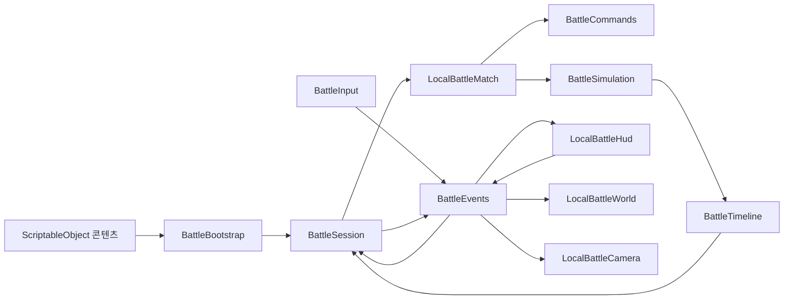

# 인게임 구조

새 인게임의 코드는 `Assets/Game`에 모은다. 기존 `Assets/Scripts`, `Assets/Editor`, `Assets/Tests`는 이전 프로토타입과 그 회귀 검증이다. 공통 초상화와 임시 모델을 재사용하되, 새 전투 코어는 이전 프로토타입 어셈블리에 의존하지 않는다.

## 디렉토리와 책임

| 디렉토리 | 책임 |
|---|---|
| `Runtime/Domain` | Unity 참조가 없는 상태·명령 검증·거리·경로·관측·전투 시뮬레이션·턴 상태 전이 |
| `Runtime/Data` | CharacterDefinition, EquipmentDefinition, FieldDefinition, BattleConfiguration ScriptableObject |
| `Runtime/Application` | 씬 구성, 경기 세션·시계·선택 상태·재생 진행, 씬 단위 타입 이벤트 채널, 턴 시작 음향 |
| `Runtime/Input` | 키보드·마우스·터치, UI와 월드 입력 구분, 카메라 드래그와 수동 경로 드래그 구분 |
| `Runtime/Presentation/World` | 타일·캐릭터·마지막 관측·아이템·구조물·경로·공격 효과 표시 |
| `Runtime/Presentation/Camera` | 플레이어 방향, 드래그·줌·포커스, 판정 중 자동 추적과 수동 조작 잠금 |
| `Runtime/Presentation/UI` | HUD·카드·AP·모달·가로/세로 안전 영역 배치 |
| `Editor` | 없는 기본 데이터·모델·소리를 생성하고 새 씬·세션 프리팹을 저작하는 도구 |
| `Data`, `Art`, `Prefabs`, `Scenes` | 편집할 SO와 에셋·프리팹·진입 씬 |
| `Tests/EditMode`, `Tests/PlayMode` | 규칙·데이터·저작 상태·실제 플레이와 입력 회귀 |

## 연결

`BattleBootstrap`만 Inspector 참조를 조합한다. `BattleEvents`는 그 세션의 명령 요청·변경 알림·포커스·연출 신호를 전달한다. 정적 전역 버스나 씬 사이에 남는 singleton을 두지 않는다. 다른 경기·테스트·씬 재로드의 리스너가 섞이지 않도록 버스 수명을 경기 씬에 묶었다. 이벤트를 구독하는 뷰는 파괴 시 구독을 해제한다.

입력은 HUD와 월드 표시를 직접 수정하지 않는다. HUD도 전투 상태를 직접 변경하지 않는다. 요청은 세션을 거쳐 `LocalBattleMatch`에서 검증하고, UI는 플레이어별 `BattleView`와 관측 데이터로 표시한다. 비용·행동 정보 조회는 전달받은 유닛 스냅샷을 사용하므로 숨은 적의 실제 장비·쿨다운을 조회하지 않는다.

`BattleSession.Initialize`로 설정을 교체해도 이벤트를 다시 중복 구독하지 않는다. REMATCH는 경기 데이터·선택·시계·관측을 초기화하고 씬 서비스를 재생성하지 않는다.

## 판정과 연출

판정은 입력 상태를 복사해 우선순위 1~4를 처리한다. 비용은 각 행동 실행 시 차감한다. 같은 우선순위의 공격은 유효한 공격을 먼저 모두 수집하고 피해를 한꺼번에 반영한다. 이전 단계에서 죽은 캐릭터는 후순위 비용을 소비하지 않는다.

각 단계는 전후 상태와 연출 큐를 `BattleTimeline`에 남긴다. 세션은 관측 가능한 큐만 받아 자기 팀 공격부터 표시한 뒤 공통 결과를 보여준다. 아직 보여주지 않은 상호 공격자가 판정 결과상 사망했어도 단계 전 상태에서 연출하므로 공격이 누락되지 않는다. 다음 턴의 AP와 준비 시간은 재생 완료 뒤에 시작한다.

적의 숨은 출발점은 공개 큐에서 제거하며 카메라에 전달하지 않는다. 정상 시야의 UI에는 적 AP와 명령이 없다. `DebugSnapshot()`과 DEBUG VISION은 로컬 테스트 도구이며 향후 온라인 전송 데이터로 사용하면 안 된다.

## 후속 확장 경계

- 새 캐릭터·장비의 수치와 외형 교체는 데이터 에셋에서 진행한다. 새로운 효과 종류를 추가할 때만 해당 도메인 판정과 표시를 확장한다.
- 원문에 정의되지 않은 아이템 종류를 임의로 채우지 않았다. 후속 아이템 콘텐츠는 별도 데이터 정의와 인벤토리 동작을 추가한다.
- 온라인에서는 입력/뷰의 형태를 유지하면서 로컬 세션의 판정 권위를 서버 서비스로 교체한다. 현재 전체 상태 스냅샷을 클라이언트 공개 API로 승격하지 않는다.
- 저장·계정 성장·필드 편집 UI는 경기 판정이나 HUD에 섞지 않고 별도 기능으로 붙인다.
- 로컬 임시 해석과 시험 범위는 [LocalPlaytest.md](LocalPlaytest.md), 요구사항 상태는 루트 [DevelopmentPlan.md](../DevelopmentPlan.md)에서 관리한다.
