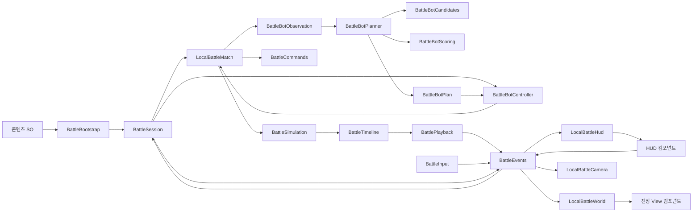

# 현재 인게임 구조

| 항목 | 내용 |
|---|---|
| Git 최초 확인 | 2026-10-22, eba3e9b |
| 직전 마지막 커밋 | 2026-10-23, ed5cc8a. 디렉터리 이전 포함 총 3개 커밋 |
| 현재 점검 / 갱신 | 2026-10-29, 로컬 봇 판단·세션/설정·진단 연결 반영 |
| 역할 / 관리 조건 | 현재 코드의 책임·호출 관계·명세 적용 지점. 구조 변경 시 갱신 |
| 게임 기준 / 차이 추적 | [DevelopmentPlan.md](DevelopmentPlan.md) / [Development.md](Development.md#2-명세와-현재-구현의-차이) |
| 이전 판본 | [재편 전 구조 문서](Archive/2026-10-28/GameArchitecture.md) |

## 1. 디렉터리와 책임

경로는 Unity 프로젝트 TurnZero를 기준으로 한다. 현재 로컬 씬은 Assets/ProjectFiles/Scenes/LocalBattle.unity다. 이전 프로토타입은 Assets/ProjectFiles/Prototype에 유지하며 현재 코어와 구분한다.

| 위치 | 책임 / 주요 타입 |
|---|---|
| [Scripts/Domain](../TurnZero/Assets/ProjectFiles/Scripts/Domain) | Unity/UI를 참조하지 않는 상태·예약 검증·경로·관측·시뮬레이션. LocalBattleMatch, BattleCommands, BattleSimulation, BattleVisibility, Bots의 관측/후보/점수/계획 |
| [Scripts/Data](../TurnZero/Assets/ProjectFiles/Scripts/Data) | 캐릭터·장비·필드·경기 설정 SO를 일반 C# 규칙 데이터로 복사 |
| [Scripts/Application](../TurnZero/Assets/ProjectFiles/Scripts/Application) | BattleBootstrap 조합, BattleSession 경기/선택/시계 연결, BattlePlayback 공개 기록 재생, 씬 소유 BattleEvents, 경기 소유 BattleBotController |
| [Scripts/Input](../TurnZero/Assets/ProjectFiles/Scripts/Input) | BattleInput의 키보드·마우스·터치, UI/전장 입력 구분 |
| [Presentation/World](../TurnZero/Assets/ProjectFiles/Scripts/Presentation/World) | 타일맵 좌표·모델·경로·아이템·설치물·마지막 관측·효과 |
| [Presentation/Audio](../TurnZero/Assets/ProjectFiles/Scripts/Presentation/Audio) | BattleAudio의 턴 시작 사운드 재생 |
| [Presentation/Camera](../TurnZero/Assets/ProjectFiles/Scripts/Presentation/Camera) | LocalBattleCamera의 방향·드래그·줌·포커스·재생 추적 |
| [Presentation/UI](../TurnZero/Assets/ProjectFiles/Scripts/Presentation/UI) | LocalBattleHud의 카드·AP·인벤토리·모달·안전 영역 |
| [Editor](../TurnZero/Assets/ProjectFiles/Editor) | LocalPlaytestAuthoring 메뉴, LocalPlaytestBuilder 씬 조합, LocalFieldMapBuilder·LocalHudBuilder 저작, LocalGameContent 기본 에셋 |
| [Data](../TurnZero/Assets/ProjectFiles/Data), [Prefabs](../TurnZero/Assets/ProjectFiles/Prefabs), [Scenes](../TurnZero/Assets/ProjectFiles/Scenes) | 편집 가능한 경기/콘텐츠 데이터·세션 프리팹·씬 |
| [Tests](../TurnZero/Assets/ProjectFiles/Tests) | 현재 인게임의 EditMode·PlayMode 검증 |
| [Prototype](../TurnZero/Assets/ProjectFiles/Prototype) | 이전 전투 코어·맵·뷰·테스트의 회귀용 보관 |

External은 가져온 에셋, Resources는 런타임 로드용 공통 이미지다. 구조 조사 시 현재 게임 코드는 ProjectFiles부터 확인한다.

### 1.1. 네임스페이스와 어셈블리

현재 게임의 기본 네임스페이스는 TurnZero다. 폴더와 어셈블리로 책임·Unity 의존성·빌드 대상을 구분한다.

| 코드 | 네임스페이스 | 어셈블리 |
|---|---|---|
| Domain | TurnZero | TurnZero.Domain |
| 런타임·데이터·입력·표현 | TurnZero | TurnZero.Runtime |
| 에디터 저작 도구 | TurnZero.Editor | TurnZero.EditorTools |
| EditMode 검사 | TurnZero.Tests | TurnZero.Tests.EditMode |
| PlayMode 검사 | TurnZero.Tests | TurnZero.Tests.PlayMode |

기존 프로토타입의 어셈블리는 유지한다. 모든 어셈블리 이름을 고유하게 두며 현재 게임과 프로토타입의 동일 네임스페이스 내 타입 이름 충돌은 없다. asmdef와 스크립트의 meta GUID를 유지하고 SO·프리팹의 클래스 식별자도 함께 갱신했다.

### 1.2. 스크립트 배치와 공통 정의

```
Scripts/
  Domain/
    Definitions/    GameDefinitions, GameRules, ActionSpec, CharacterSpec, EquipmentSpec
    State/          MatchState, BattleUnit/Base/Structure, FireZone, GroundItem
    Commands/       BattleCommands, BattleOrder
    Grid/           GridCell, BattlePathfinding
    Simulation/     페이즈 실행·비용·이동·공격·장비·획득·부활·사망 경계·승패
    StatusEffects/  BattleStatusEffects, StatusEffect, StatusEffectDefinition
    Visibility/     BattleVisibility, BattleView, UnitObservation
    Timeline/       BattleTimeline, ResolutionStep, BattleCue
    LocalBattleMatch.cs
    TurnZero.Domain.asmdef
  Application/      BattleBootstrap, BattleSession, BattleEvents, BattlePlayback
  Data/             Unity의 경기·캐릭터·장비·필드 설정 에셋 타입
  Input/            BattleInput
  Presentation/
    Audio/          BattleAudio
    Camera/         LocalBattleCamera
    UI/             HUD·카드·AP·레이아웃
    World/          타일맵·캐릭터·전장 표시

Editor/
  Playtest/         실행 메뉴·씬/HUD/필드 생성·기본 콘텐츠
  Fields/           필드 Inspector·브러시/팔레트 연계
```

[GameDefinitions.cs](../TurnZero/Assets/ProjectFiles/Scripts/Domain/Definitions/GameDefinitions.cs)는 공통 구조 상수·에셋 경로·불변 상태 효과 정의와 enum 9종을 한곳에 둔다. enum의 정수 값은 기존 직렬화 값과 행동 인덱스를 보존하도록 명시했다.

다른 클래스는 파일명과 주요 타입명을 맞춘다. GameDefinitions.cs의 공통 enum 모음은 여러 타입을 허용하는 예외다. 함수·테스트 내부 전용 상수는 사용처에 유지하며 밸런스 값은 GameRules/ScriptableObject에서 편집한다.

.asmdef 경계·네임스페이스·스크립트 meta GUID를 유지해 이동 전후의 씬/프리팹 참조가 같다. .NET 검사는 Domain 하위 폴더를 재귀적으로 포함한다. 프로토타입의 디렉터리와 코드에는 적용하지 않는다.

### 1.3. C# 서식 기준

현재 게임·에디터·테스트·보관 프로토타입과 코어 검사 실행기에 같은 가독성 기준을 적용한다. 공백 4칸과 Allman 중괄호, 명시적 타입, 선언당 변수 하나, 블록 형태의 메서드, 메서드 사이 빈 줄을 사용한다. 긴 조건·호출·초기화와 관련 처리 묶음은 줄바꿈/빈 줄로 구분한다. 간단한 속성과 람다식은 간결한 표현을 허용한다.

줄바꿈한 조건식·인자·메서드 체인은 기준 문장이나 호출보다 4칸 더 들여쓴다. 여러 줄 람다의 중괄호는 람다를 시작하는 호출 줄에 맞추고 본문은 4칸 더 들여쓴다. 화살표의 가로 위치나 기존 들여쓰기를 기준으로 추가 공백을 누적하지 않는다.

지속적인 작성 기준은 [AGENTS.md](../AGENTS.md), IDE 서식·타입·중괄호 안내는 [.editorconfig](../.editorconfig)에서 관리한다. 서식 정리 시 이름·공개 타입·직렬화 필드·특성·enum 값·문자열/수치를 유지한다. 외부 에셋과 Unity 생성 코드는 대상에서 제외한다.

## 2. 연결과 소유



- BattleBootstrap은 Inspector 참조를 조합하고 BattleSession이 경기 수명을 관리한다.
- BattleEvents는 경기 씬에 속하는 요청/알림 채널이다. 정적 전역 버스로 다른 경기 리스너를 공유하지 않는다.
- 입력/HUD 요청은 세션을 거쳐 코어에서 검증한다. 뷰가 전투 상태를 직접 수정하지 않는다.
- 표시에는 플레이어별 BattleView와 관측 기록을 사용한다. 숨은 실제 상태를 디버그 스냅샷에서 가져오지 않는다.
- 경기마다 SO에서 규칙/상태를 복사하며 실행 중 HP·AP를 원본 에셋에 저장하지 않는다.
- 봇 컨트롤러는 경기마다 생성한다. 정상 팀 View에서 복사한 자료로 준비 진입 때 한 번만 판단하고 화면 Player/RevealAll과 분리한다.
- 재시작은 경기 데이터·선택·시계·관측·봇 계획/실행 횟수를 초기화한다. 데이터 변경 후 새 경기에서 반영 여부를 확인한다.


### 2.1. 오브젝트별 View 구성

BattleView는 플레이어에게 공개할 정보를 담는 일반 C# 데이터다. GameObject에는 아래 MonoBehaviour를 붙인다. LocalBattleHud와 LocalBattleWorld는 각 컴포넌트에 같은 View를 전달하는 조합 역할을 맡고, 개별 텍스트·버튼·전장 표시는 해당 컴포넌트에서 관리한다.

| 오브젝트 | 컴포넌트 | 책임 |
|---|---|---|
| Game HUD | LocalBattleHud | HUD 컴포넌트 연결과 공통 상태·공개 큐 전달 |
| Match header | LocalMatchHeaderView | 턴 단계·양 팀 기지 HP·관점 표시 |
| Timer | LocalTurnTimerView | 남은 시간을 읽어 표시 숫자가 바뀔 때 갱신 |
| Message and log | LocalBattleMessageView | 안내 메시지와 최근 전투 로그 표시 |
| Selection header | LocalSelectionView | 선택 캐릭터의 초상·HP·상태·예약 표시 |
| Action buttons | LocalActionButtonsView | 행동 선택 버튼과 비용·쿨다운·사용 가능 상태 |
| Action detail | LocalActionDetailsView | 선택 행동의 거리·범위·페이즈·설명 표시 |
| Equipment crafting | LocalEquipmentView | 제작 버튼·보유 재료·교체 확인 요청 |
| Replace equipment | LocalEquipmentConfirmationView | 장비 교체 확인·취소 처리 |
| Local test toolbar / Ready | LocalBattleToolbarView / LocalReadyButtonView | 관점·재생·타이머·가이드·재시작 / 준비·해제 요청 |
| Match setup | LocalBattleSetupView | 필드·장비 덱 선택과 배치 시작 |
| Controls guide / Match result / Turn banner | LocalBattleHelpView / LocalBattleResultView / LocalTurnBannerView | 도움말 / 경기 결과·재시작 / 턴 시작 안내 |
| World | LocalBattleWorld | 전장 컴포넌트 연결과 좌표·선택 조회 제공 |
| Field / 12 x 20 | LocalTileHighlightsView + 기존 LocalFieldMap·LocalTileView | 배치·이동·공격 범위와 선택 타일 표시 |
| Characters and bases | LocalActorsView + 기존 LocalActorView | 캐릭터·기지·관측 기억·겹침 배치·이동 큐 표시 |
| Planned path | LocalPathView | 재사용 버퍼로 예약·미리보기 경로 표시 |
| Items, structures and effects / Field markers | LocalWorldMarkersView | 아이템·설치물·지속 지대와 관측 기억 표시 |
| Items, structures and effects / Battle effects | LocalBattleEffectsView | 공개 투사체·피격 범위 재생과 재시작 시 정리 |

LocalRosterCard·LocalApPanel·LocalHudLayout은 기존 오브젝트에서 카드·AP·반응형 배치를 계속 담당한다. 버튼 리스너는 각 패널이 등록·해제하며, HUD를 다시 Bind해도 중복 등록하지 않는다. 초기 비활성 팝업도 조합 루트에서 참조하고 Render하므로 상태에 따라 다시 표시할 수 있다.

BattleSession.View는 경기 Revision, 재생 Revision, 관점, 디버그 공개 여부가 같으면 표시 데이터를 재사용한다. 선택·호버·경로 미리보기 갱신은 기존 데이터를 공유하고, 예약·제작·준비·배치·턴 전환·재생 피해/시야 변화는 새 데이터를 만든다. 현재 시간은 SecondsLeft로 따로 읽으며 타이머 Update에서는 전체 View를 요청하지 않는다. 공유 View의 컬렉션과 캐릭터 상태는 표시 코드에서 수정하지 않는다.

새 경기 변경 경로를 추가할 때 LocalBattleMatch.Revision을 갱신하고, 재생 중 Display를 바꿀 때 BattlePlayback의 Refresh 경계를 사용한다. 이전/이후 재생 기록의 가변 컬렉션을 View 캐시와 공유하거나 시야 밖 실제 상태로 대체하지 않는다.

LocalHudBuilder.WireViews와 LocalPlaytestBuilder.WireWorldViews가 씬 저작 시 같은 구성을 만든다. 현재 세션 프리팹은 기존 오브젝트·배치·모델/텍스트 참조를 유지해 이 구조로 갱신했다.


### 2.2. 반복 입력·표시 경로의 할당 관리

프레임 입력과 반복 표시 경로에는 불필요한 LINQ 조회·정렬·중간 컬렉션 생성을 피한다. 초기화·에디터·작은 고정 목록은 가독성을 함께 고려한다. 전투 실행 순서를 보장하는 정렬과 기록/관측의 독립 복사본은 성능 정리 때문에 생략하지 않는다.

| 경로 | 현재 처리 |
|---|---|
| BattleInput.Update | 활성 터치의 앞 두 좌표를 직접 읽고 키 배열을 재사용한다. 휠 변화가 있을 때만 추가 UI 판정을 한다. |
| BattleInput.OverUI | EventSystem이 바뀔 때 PointerEventData를 만들고 이후 재사용한다. 기존 hits 버퍼에서 Canvas 여부를 조기 반환한다. |
| BattleSession.PreviewPath | 호출자 버퍼의 값을 복사하되 기존 표시 버퍼는 재사용한다. 내용이 같은 요청에는 Changed를 다시 보내지 않는다. |
| BattleView 조회 | 관측 유닛·기억·예약을 직접 조회하고, 겹친 타일 선택은 자기 팀·ID 순서와 순환을 유지하며 정렬 목록 없이 다음 대상을 찾는다. |
| LocalTileHighlightsView | 예약 위치·교환 대상·미리보기 위치를 재사용 HashSet에 한 번 모은 후 타일별 Contains로 표시한다. |
| 경로·시야·기지 판정 | 인접 방향 배열을 재사용하고 단순 필터/존재 확인을 반복문으로 처리한다. 경로 동률 기준과 숨은 기지·은신·정찰 규칙은 유지한다. |
| 비활성 설정 패널 | 경기 중에는 덱·필드·로스터 텍스트를 다시 만들지 않는다. 설정 화면에서는 로스터 문자열을 한 번 만들어 공유한다. |

PathPreview와 타일 조회용 버퍼는 일시 표시 자료이며 경기 기록에 넘겨 공유하지 않는다. BattleVisibility의 View 복사, 딕셔너리 관측 기억을 제거하기 전의 안전한 스냅샷, 페이즈/공개 큐 정렬은 필요한 데이터 수명과 순서를 유지한다. 전체 프레임의 GC가 0이라는 의미는 아니며 실제 CPU/GC 개선량은 목표 기기에서 프로파일링한다.

## 3. 판정과 재생의 현재 연결

LocalBattleMatch가 경기 상태를 소유한다. 예약은 BattleCommands로 검증하고, BattleSimulation은 복사한 상태에 행동 페이즈 0~4를 실행한다. 판정에는 프레임 시간이나 화면 시점을 사용하지 않는다.

| 타입 | 한 문장으로 설명한 책임 |
|---|---|
| LocalBattleMatch | 편성·배치·준비·예약을 받아 경기 상태와 턴 수명을 진행한다. |
| BattleCommands | 현재 상태와 규칙에서 예약 명령의 유효성과 비용을 계산한다. |
| BattlePathfinding | 허용된 타일을 이용해 고정 순서의 최단 경로와 도달 영역을 계산한다. |
| BattleSimulation | 행동 페이즈별 실행 순서와 턴 마무리를 조합한다. |
| BattleCosts | 실제 행동 시작 시 AP와 해당 행동의 재사용 턴을 반영한다. |
| BattleRevival | 페이즈 0에서 유효한 부활 명령과 도착 접촉을 실행한다. |
| BattleMovement | 같은 페이즈의 전체 이동을 공통 스텝으로 확정하고 포털·접촉을 집계한다. |
| BattleCombat | 유효 공격과 유지 지대의 적중을 수집하고 피해·공격 효과를 적용한다. |
| BattleEquipment | 공통 시작 상태에서 교환·설치 경합을 검증하고 유효 장비 행동을 실행한다. |
| BattleItems | 실제 도착 접촉의 팀별 지급과 제작 재료의 생성 후보·추첨을 처리한다. |
| BattlePhaseCompletion | 페이즈 종료에 캐릭터 사망·설치물 유효화·포털 완성을 확정한다. |
| BattleVictory | 기지 파괴와 생존 인원 조합으로 승패를 판정한다. |
| BattleStatusEffects | 효과 정의에 따라 부여·대기·활성·갱신·만료·전체 해제를 처리한다. |
| BattleVisibility | 현재 시야와 관측 기억으로 플레이어에게 공개할 정보를 계산한다. |
| BattleTimeline | 판정 단계의 이전·이후 상태와 큐를 순서대로 보관한다. |
| ResolutionStep | 해당 시점에 공개할 큐를 추리고 공격별 표시 상태를 재구성한다. |
| BattleSession | 씬 요청·선택·로컬 시계와 경기·재생의 연결을 관리한다. |
| BattlePlayback | 공개 큐의 재생 시간·동시 이동·순차 공격·표시 상태를 진행한다. |

GameRules·ActionSpec·CharacterSpec·EquipmentSpec은 규칙 데이터다. MatchState·BattleUnit·BattleBase·BattleOrder·BattleStructure·FireZone·GroundItem·StatusEffect는 경기별 상태이며 복사 시 가변 컬렉션도 분리한다. BattleView·UnitObservation·BattleCue는 공개 표시와 기록에 사용하는 자료다. 클래스는 주요 타입과 파일명을 맞추며 공통 상수·enum은 GameDefinitions.cs에 모은다.

**판정과 표시의 경계**

- 부활은 0, 이동·공격·장비는 지정 페이즈에 실행한다. 같은 페이즈 이동은 모든 위치를 확정한 뒤 관측한다.
- 일반 도착·포털 입구·출구 접촉을 같은 이동 스텝에 합쳐 먼저 팀별 수령을 결정하고 실제 아이템을 제거한다.
- 공격은 유효한 명령과 적중을 먼저 수집하므로 같은 페이즈에 HP 0이 되어도 이미 유효한 공격을 보장한다.
- HP 0 캐릭터는 DefeatPending 동안 재생에 남고, 페이즈 종료에 장비 파괴·쿨다운 초기화·처치 보상 적립을 확정한다. AP 지급은 턴 마무리에 한다.
- 유지 지대는 생성 포함 SkillDuration 동안 유지하며 이후 턴의 원래 스킬 페이즈에 자동 발동한다.
- 설치 직후 기록의 Active는 false다. 종료 단계에서 유효화하고, 포털은 정해진 턴의 페이즈 4 종료에 Completed가 된다.
- BattlePlayback은 같은 이동 스텝의 큐를 같은 프레임에 보내며, 공격·교환은 자기 팀 → 상대 팀 번호순으로 재생한다. 유지 지대는 해당 소유 팀의 일반 공격보다 앞선다.
- 적 이동의 숨은 끝점과 공격의 숨은 발사 위치·범위를 공개 큐에서 가린다. 공개 큐가 없는 이동 스텝은 카메라 전환과 재생 대기를 만들지 않는다.
- 공개 HP는 공격별로 갱신하고 최종 사망은 페이즈 종료 기록에서 갱신한다. 화면 재생은 실제 판정을 다시 실행하지 않는다.
- 시뮬레이션 재생을 마치면 임시 공격 시야를 정리한다. 경기 종료와 다음 턴 진입에 같은 경계를 적용한다.
- 사망은 전역 공개하되 숨은 사망 위치를 새로 전달하지 않는다. 숨은 부활은 재관측 전까지 기존 사망 기록을 유지한다.
- 아이템·적 설치물은 관측 기억을 별도로 보관한다. 시야 밖 획득/파괴로 회색 기억을 갱신하지 않는다.

ActionSpec.Priority와 BattleCommands.Priority의 기존 코드 식별자는 직렬화/호출 호환을 위해 유지하며 의미는 **행동 페이즈**다. BattlePhase는 경기의 큰 턴 단계를 나타낸다. 쿨다운은 ReadyOn의 재사용 가능 턴으로 저장하고 UI에서 현재 턴과의 차이를 표시한다.

## 4. 기능별 수정 지점

| 명세 시스템 | 주로 확인할 코드 |
|---|---|
| 편성·턴·예약 | LocalBattleMatch, BattleCommands, BattleSession, BattleConfiguration |
| 비용·사망·부활·승패 | BattleCosts, BattlePhaseCompletion, BattleRevival, BattleVictory |
| 이동·획득·설치 | BattlePathfinding, BattleMovement, BattleItems, BattleEquipment |
| 공격·지대 | BattleCombat, FireZone, CharacterSpec |
| 상태 효과 | GameDefinitions의 불변 효과 정의, StatusEffectDefinition, StatusEffect, StatusEffectKind, BattleStatusEffects |
| 시야·정보 공개 | BattleVisibility, UnitObservation, ResolutionStep, BattleView |
| 재생·카메라 | BattlePlayback, BattleEvents, LocalBattleCamera |
| 입력·HUD·월드 | BattleInput, LocalBattleHud/World의 조합 루트와 2.1의 오브젝트별 View |
| 데이터·씬 저작 | Character/Equipment/FieldDefinition, BattleConfiguration, LocalPlaytestBuilder, LocalFieldMapBuilder, LocalHudBuilder |
| 요구사항/검증 | Development.md의 PT·R 추적, Verification.md의 TC와 실행 증거 |

입력은 대상과 의도를 전달하고, Domain이 적법성을 판정한다. 표현은 BattleView와 공개 큐만 소비한다. 저장·계정·온라인은 아직 구현 범위에 넣지 않았다. 하나의 구현을 감싸기 위한 인터페이스나 생성 계층은 추가하지 않았다.

씬의 MonoBehaviour GUID와 기존 직렬화 참조를 유지했다. 세션 종료 시 요청 구독과 재생 코루틴을 정리하고, 월드·카메라·HUD는 자신의 구독·연출 수명을 정리한다. 기본 에셋 생성, 씬 조합, 필드 저작, HUD 저작은 각각 별도 클래스로 둔다.

현재 차이 목록은 Development.md에 관리한다. 구조 변경 시 이 문서의 책임·호출 관계를 함께 갱신한다.

## 5. 확장 경계와 관리

- 온라인의 권위·복구 요구는 Q-22에서 정한다. 현재 전체 디버그 스냅샷을 정상 클라이언트 전송 규약으로 사용하지 않는다.
- 저장·계정 성장·필드 편집 UI는 해당 요구사항을 정한 뒤 별도 책임으로 추가한다.
- 캐릭터/장비 수치·외형은 데이터 에셋, 새 효과의 실제 판정은 Domain과 표시 소비 지점에서 확장한다.
- 구조 수정 시 현재 소스 경로·연결도·명세 적용 표를 갱신하고 해당 실행 증거를 Verification.md에 남긴다.

### 5.1. 로컬 봇의 연결 구조

현재 1차 봇은 일반 C# 판단 자료/계산과 세션 연결로 구성한다. 행동 규칙·점수의 기준은 [명세 4.14](DevelopmentPlan.md#414-로컬-봇)와 [5.8](DevelopmentPlan.md#58-로컬-봇-행동-평가식과-초기-조정값), 구현 상태·남은 작업은 [Development.md 5.1](Development.md#51-로컬-봇-1차-개발-계획)을 따른다.

| 위치 / 타입 | 한 문장으로 설명한 책임 |
|---|---|
| Domain/Bots/BattleBotObservation | 정상 팀 View에서 자기 상태와 공개 적 대상·기억을 독립 복사한다. |
| Domain/Bots/BattleBotTarget | 현재 관측 가능한 공격 대상의 공개 위치·HP·분류·고정 정보를 보관한다. |
| Domain/Bots/BattleBotCandidate·BattleBotCandidates | 유효 행동/경로·관측 목표·탐색 효과를 가진 유한 후보를 만든다. |
| Domain/Bots/BattleBotScore·BattleBotScoring | 관측 잔여 HP·이미 고른 공격/탐색을 반영해 후보의 점수 항목을 계산한다. |
| Domain/Bots/BattleBotPlanner | 팀 AP 안에서 최고 점수 행동을 반복 선택하고 나머지 캐릭터를 대기로 정한다. |
| Domain/Bots/BattleBotDecision·BattleBotPlan | 독립 관측·버전/규칙 식별자·시드·선택 행동/점수·예약 결과를 기록한다. |
| Application/BattleBotController | 한 경기/팀의 배치·턴별 한 번 계획·기존 Queue/Ready 연결을 진행한다. |
| BattleSession·BattleEvents·LocalBattleSetupView | 모드 설정·조작 권한·자동 배치/준비 진입·재시작·설정 버튼 수명을 연결한다. |
| Editor/Playtest/LocalBotDiagnostics | 마지막 계획을 JSON으로 내보내고 기록 관측/시드로 명령·점수 재현을 검사한다. |

각 주요 타입은 같은 이름의 파일 하나에 둔다. 판단기는 Unity·MatchState·실제 경기 객체·프레임 시간을 받지 않으며 관측과 규칙 사본을 소비한다. 컨트롤러만 LocalBattleMatch를 참조한다. 공통 모드 enum·봇 버전은 GameDefinitions, 봇 점수 가중치는 BattleBotScoring에서 관리한다. 구현 하나뿐인 인터페이스·전역 싱글톤·새 이벤트 버스·팩토리는 추가하지 않았다.

후보·점수·동률 규칙을 변경할 때 BotVersion을 갱신하고 관련 회귀를 실행한다. 게임 수치의 변경은 명세/콘텐츠와 함께 갱신하며 진단에는 규칙 사본과 RulesSignature가 남는다.

#### 5.1.1. 관측·후보·예약 연결

1. BattleSession.Update에서 Match.Tick이 준비 진입을 알리면 컨트롤러의 Prepare를 호출한다. 경기마다 새 컨트롤러를 만들고 턴 번호로 중복 실행을 막는다. 사람의 예약으로 증가하는 Revision은 재계획 조건이 아니다.
2. Capture는 Match.View(봇 팀, now, false)를 사용한다. BattleSession.View의 화면 Player/RevealAll·재생 중간 표시·DebugSnapshot을 사용하지 않는다. 적의 전체 BattleUnit을 복사하지 않고 공개 필드만 BattleBotTarget·정리된 관측 기억으로 옮긴다.
3. 후보의 경로와 목표 거리는 BattlePathfinding.Paths/Distances를 사용한다. 기존 FindPath/Reachable과 같은 탐색 루프·방향 순서를 공유하며 차단 타일은 관측한 기지로 구성한다. 캐릭터 점유·미관측 기지를 몰래 차단하지 않는다.
4. 판단기는 새 상태를 시뮬레이션하지 않고 현재 관측의 잔여 HP·고정·탐색 집계와 남은 AP만 갱신한다. 후보를 캐릭터/행동/좌표순으로 정렬하고 봇 전용 난수로 동률을 선택한다. GetHashCode·컬렉션 열거 순서·프레임 시간을 시드로 쓰지 않는다.
5. 컨트롤러는 현재 턴·now를 전달해 Queue로 예약하고 결과를 기록한다. 미지정/거절은 기존 무료 대기 규칙을 따르며 타일을 바꿔 탐지용 재시도를 하지 않는다. Ready는 토글이므로 완료하지 않은 팀에 한 번만 호출한다.

자료는 준비 진입에만 만들며 HUD 갱신·매 프레임 입력·사람 예약 변경마다 후보를 만들지 않는다. BattleBotPlan은 JsonUtility로 직렬화 가능한 관측/규칙·좌표 목록을 보관한다. 저장된 버전·규칙 식별자와 재실행한 명령/점수가 다르면 진단에서 실패를 보고한다. 현재 경기 상태를 재생하거나 변경하는 기능과 구분한다.

#### 5.1.2. 배치·모드·경기 수명

LocalBattleMatch.AutoDeploy(player, now, out error)는 한 팀의 남은 고정 배치 좌표를 먼저 검사한 뒤 기존 Place로 제출한다. 기존 양 팀 빠른 배치는 유지한다. 봇 대전은 P1 수동 배치 완료 후 P2 컨트롤러를 진행하고, 빠른 배치 도구는 P1과 P2를 각 유효 경로로 완료한다.

DefaultMode는 BattleConfiguration의 실행 기본값이며 설정 화면에서 모드를 바꿀 수 있다. 경기 중 모드 변경, 봇 팀 필드/덱 편집·시점 전환은 세션 진입점에서 거절하고 버튼도 비활성화한다. 전장 선택·명령·제작·완료는 계속 기존 플레이어/코어 검증을 따른다. 정상 HUD는 봇의 예약·점수를 렌더링하지 않는다.

재생 중 판단/예약하지 않으며 정상 턴 경계에서 다시 계획한다. 재시작은 선택 모드를 유지하고 새 경기·새 컨트롤러를 만들어 계획·실행 횟수·진단 상태를 초기화한다. 컨트롤러는 비동기 요청이나 전역 구독을 갖지 않는다. 씬 종료 시 세션 참조를 정리한다. 프리팹의 기존 오브젝트 ID·스크립트 GUID는 유지하고 모드 버튼과 직렬화 참조만 추가했다.
