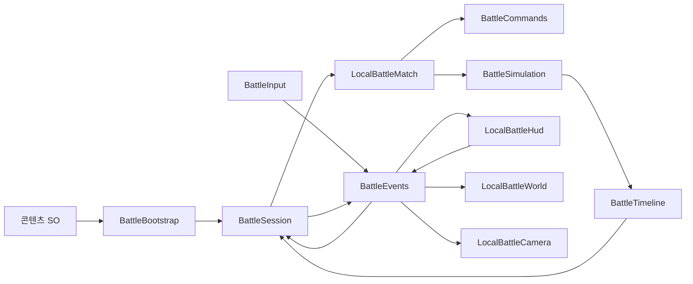

# 현재 인게임 구조

| 항목 | 내용 |
|---|---|
| Git 최초 확인 | 2026-10-22, eba3e9b |
| 직전 마지막 커밋 | 2026-10-23, ed5cc8a. 디렉터리 이전 포함 총 3개 커밋 |
| 현재 점검 / 갱신 | 2026-10-28, 작업 트리 HEAD 9f4fa25의 소스 확인 |
| 역할 / 관리 조건 | 현재 코드의 책임·호출 관계·명세 적용 지점. 구조 변경 시 갱신 |
| 게임 기준 / 차이 추적 | [DevelopmentPlan.md](DevelopmentPlan.md) / [Development.md](Development.md#2-명세와-현재-구현의-차이) |
| 이전 판본 | [재편 전 구조 문서](Archive/2026-10-28/GameArchitecture.md) |

## 1. 디렉터리와 책임

경로는 Unity 프로젝트 TurnZero를 기준으로 한다. 현재 로컬 씬은 Assets/ProjectFiles/Scenes/LocalBattle.unity다. 이전 프로토타입은 Assets/ProjectFiles/Prototype에 유지하며 현재 코어와 구분한다.

| 위치 | 책임 / 주요 타입 |
|---|---|
| [Scripts/Domain](../TurnZero/Assets/ProjectFiles/Scripts/Domain) | Unity/UI를 참조하지 않는 상태·예약 검증·경로·관측·시뮬레이션. LocalBattleMatch, BattleCommands, BattleSimulation, BattleVisibility |
| [Scripts/Data](../TurnZero/Assets/ProjectFiles/Scripts/Data) | 캐릭터·장비·필드·경기 설정 SO를 일반 C# 규칙 데이터로 복사 |
| [Scripts/Application](../TurnZero/Assets/ProjectFiles/Scripts/Application) | BattleBootstrap 조합, BattleSession 경기/선택/시계/재생, 씬 소유 BattleEvents, 음향 |
| [Scripts/Input](../TurnZero/Assets/ProjectFiles/Scripts/Input) | BattleInput의 키보드·마우스·터치, UI/전장 입력 구분 |
| [Presentation/World](../TurnZero/Assets/ProjectFiles/Scripts/Presentation/World) | 타일맵 좌표·모델·경로·아이템·설치물·마지막 관측·효과 |
| [Presentation/Camera](../TurnZero/Assets/ProjectFiles/Scripts/Presentation/Camera) | LocalBattleCamera의 방향·드래그·줌·포커스·재생 추적 |
| [Presentation/UI](../TurnZero/Assets/ProjectFiles/Scripts/Presentation/UI) | LocalBattleHud의 카드·AP·인벤토리·모달·안전 영역 |
| [Editor](../TurnZero/Assets/ProjectFiles/Editor) | LocalPlaytestAuthoring / LocalPlaytestBuilder, 기본 데이터·씬·프리팹 저작 |
| [Data](../TurnZero/Assets/ProjectFiles/Data), [Prefabs](../TurnZero/Assets/ProjectFiles/Prefabs), [Scenes](../TurnZero/Assets/ProjectFiles/Scenes) | 편집 가능한 경기/콘텐츠 데이터·세션 프리팹·씬 |
| [Tests](../TurnZero/Assets/ProjectFiles/Tests) | 현재 인게임의 EditMode·PlayMode 검증 |
| [Prototype](../TurnZero/Assets/ProjectFiles/Prototype) | 이전 전투 코어·맵·뷰·테스트의 회귀용 보관 |

External은 가져온 에셋, Resources는 런타임 로드용 공통 이미지다. 구조 조사 시 현재 게임 코드는 ProjectFiles부터 확인한다.

## 2. 연결과 소유

- BattleBootstrap은 Inspector 참조를 조합하고 BattleSession이 경기 수명을 관리한다.
- BattleEvents는 경기 씬에 속하는 요청/알림 채널이다. 정적 전역 버스로 다른 경기 리스너를 공유하지 않는다.
- 입력/HUD 요청은 세션을 거쳐 코어에서 검증한다. 뷰가 전투 상태를 직접 수정하지 않는다.
- 표시에는 플레이어별 BattleView와 관측 기록을 사용한다. 숨은 실제 상태를 디버그 스냅샷에서 가져오지 않는다.
- 경기마다 SO에서 규칙/상태를 복사하며 실행 중 HP·AP를 원본 에셋에 저장하지 않는다.
- 재시작은 경기 데이터·선택·시계·관측을 초기화한다. 데이터 변경 후 새 경기에서 반영 여부를 확인한다.

## 3. 판정과 재생의 현재 연결

[LocalBattleMatch.Resolve](../TurnZero/Assets/ProjectFiles/Scripts/Domain/LocalBattleMatch.cs)는 [BattleSimulation.Resolve](../TurnZero/Assets/ProjectFiles/Scripts/Domain/BattleSimulation.cs)에 상태를 전달하고, 결과를 [BattleTimeline](../TurnZero/Assets/ProjectFiles/Scripts/Domain/BattleTimeline.cs)에 담는다. 각 ResolutionStep은 Before/After 상태와 Cues를 갖는다. [BattleSession](../TurnZero/Assets/ProjectFiles/Scripts/Application/BattleSession.cs)은 공개 가능한 큐를 재생한 뒤 다음 턴으로 진행한다.

현재 소스는 행동 정수 1~4를 순회한다. 이동에는 칸별 루프가 있지만 같은 칸 처리 안에 개별 캐릭터의 획득/피해가 섞여 있고, 세션은 큐를 순차 재생한다. 공격은 피해를 수집해 반영하며 재생 단계의 공개 HP/사망 경계는 최신 명세에 맞춰 수정·검증해야 한다.

| 명세의 처리 단위 | 현재 코드 대응 | 적용할 계약 |
|---|---|---|
| 턴 단계 | BattlePhase, LocalBattleMatch, BattleSession | 턴 시작/준비/재생/종료 경계와 중복 실행 방지 |
| 행동 페이즈 | ActionSpec.Priority, BattleCommands.Priority, BattleSimulation의 정수 순회 | 명세 0~4, 부활 0과 효과별 종료 경계 |
| 이동 스텝 | BattleSimulation.Move의 index 루프, ResolutionStep | 전체 위치 확정 뒤 관측/접촉 기록, 화면 동시 재생 |
| 공격 묶음 | BattleSimulation.Attack의 피해 수집 | 유효 공격 보장·공격별 공개 HP·페이즈 종료 사망 |
| 공개 기록 | BattleVisibility, BattleTimeline.ForPlayer | 관측 당시 정보만 전달, 숨은 경로·시야 밖 현재 상태 차단 |
| 상태 효과 | BattleUnit.HiddenThrough·RootFrom·RootThrough | SYS-STATUS의 정의/적용 상태·대기/활성·조회 연계로 확장 |

이 표는 적용 지점을 설명한다. 새 StatusEffect 타입이나 페이즈 0 지원이 이미 구현됐다는 뜻은 아니다. 코드 식별자 Priority/BattlePhase는 문서 용어 변경만으로 이름을 바꾸지 않았다.

## 4. 기능별 수정 지점

| 명세 시스템 | 주로 확인할 코드 |
|---|---|
| 편성·턴·AP | LocalBattleMatch, BattleCommands, BattleSession, BattleConfiguration |
| 이동·공격·사망·설치·획득 | BattleSimulation, BattleState, BattleTimeline |
| 시야·정보 공개·은신 간파 | BattleVisibility, BattleTimeline, World/UI 표시 |
| 상태 효과 | BattleState/BattleSimulation의 전용 필드와 이동·관측·부활 소비 지점 |
| 입력·카메라·HUD | BattleInput, BattleSession, LocalBattleWorld/Camera/Hud |
| 데이터·씬 저작 | Character/Equipment/FieldDefinition, BattleConfiguration, LocalPlaytestBuilder |
| 요구사항/검증 | Development.md의 PT·R 추적, Verification.md의 TC와 실행 증거 |

현재 차이 목록은 Development.md에 한 번만 관리한다. 여기에는 변경된 책임·호출 관계와 적용 경계를 갱신한다.

## 5. 확장 경계와 관리

- 온라인의 권위·복구 요구는 Q-22에서 정한다. 현재 전체 디버그 스냅샷을 정상 클라이언트 전송 규약으로 사용하지 않는다.
- 저장·계정 성장·필드 편집 UI는 해당 요구사항을 정한 뒤 별도 책임으로 추가한다.
- 캐릭터/장비 수치·외형은 데이터 에셋, 새 효과의 실제 판정은 Domain과 표시 소비 지점에서 확장한다.
- 구조 수정 시 현재 소스 경로·연결도·명세 적용 표를 갱신하고 해당 실행 증거를 Verification.md에 남긴다.
